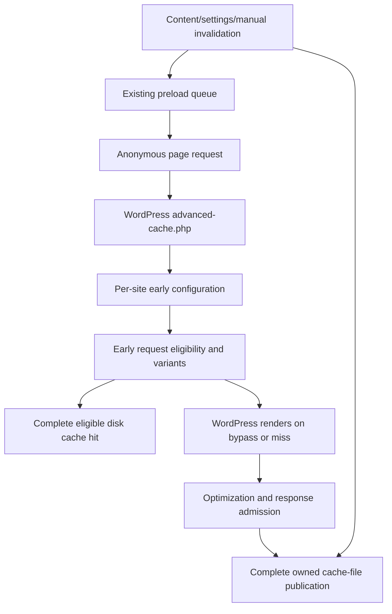
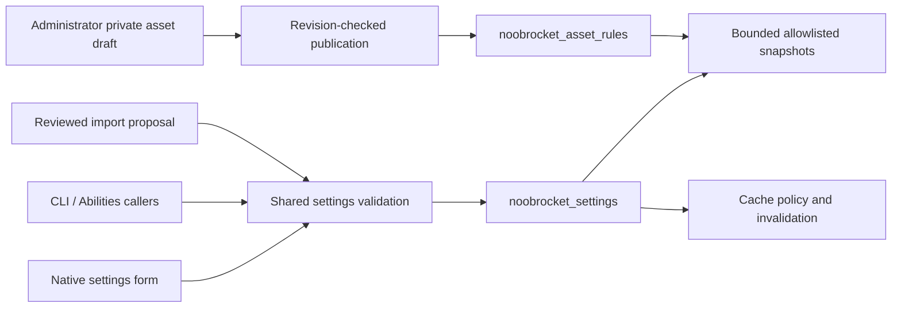

# Architecture and ownership

Cache-Cache uses the inherited WordPress hook/subscriber/container architecture. [Plugin.php](../noobrocket/inc/Plugin.php) registers service providers and activates subscribers through [Event_Manager](../noobrocket/inc/classes/event-management/class-event-manager.php). Trace registration, not filenames alone: some inherited cloud/license/monitoring classes remain present while their service paths are disabled. No new provider, context or interface is required merely because a feature is added.

The unused SaaS admin provider is no longer registered. Retained legacy services have concrete callers: settings and local CDN still depend on License `User`/`UserClient`; BYO CDN subscribers and its driver factory still use HostedCDN query/subscription services; local Beacon uses Support data, while preload uses its mobile detector. `TrackingTrait` remains used by Abilities/CDN and emits a public integration hook. The vendor sender subscriber is not activated, analytics stays disabled by the free-edition policy, and retained files alone do not establish remote requests. Removing these shared services requires an explicit compatibility refactor rather than deleting directories by name.

## Request and page-cache path

| Responsibility | Maintained owner | Contract |
| --- | --- | --- |
| Bootstrap, product constants and activation | `noobrocket/noobrocket.php`, `inc/Plugin.php`, `inc/functions/` | Preserve plugin path, data identifiers and shared drop-in ownership. |
| Early loader and per-site configuration | `inc/Engine/Cache/AdvancedCache.php`, `Config/`, `inc/classes/Buffer/class-config.php` | Only an explicitly owned `advanced-cache.php` may be replaced. Early config is executable policy. Shared-root cleanup enumerates every site across networks, restores switched blog context in `finally` and stops when the directory listing is unavailable. |
| Early eligibility, response admission, variants and publication | `inc/classes/Buffer/class-tests.php`, `class-cache.php`, `class-abstract-buffer.php` | Public anonymous responses only; complete files, scheme/device/cookie/query rules and privacy headers remain authoritative. |
| URL/content invalidation | `inc/Engine/Cache/Purge.php`, `UrlValidation/`, `inc/functions/files.php` | Purge affected archives/pagination and old/new URLs; preserve unrelated cache owners/sites. |
| Expiry and optional stale refresh | `inc/Engine/Cache/PurgeExpired/` and early buffer policy | Full-tree scanning remains proportional to owned files; appending deleted paths avoids repeated accumulated-list copies. Purge hook paths remain unique. PHP enforces the stale hard cutoff; direct static HTML cannot. |
| Preload discovery, admission and completion | `inc/Engine/Preload/Frontend/`, `Controller/`, `Database/`, `Cron/` | Native queue normalization, pending/running deduplication and usable required variants determine completion. Activation queues work. |

The early hit bypasses normal plugin boot. PHP hits expose `Cache-Status: NoobRocket; hit`; static Apache/Nginx delivery uses server rules and does not execute that header path. Publication locks prevent competing file writers from publishing partial output; they do not serialize all cold WordPress renders.

## Settings and admin transactions

`inc/Engine/Admin/Settings/Page.php`, `Settings.php`, `Render.php` and views own native page structure and fields. `inc/admin/options.php` applies shared domain checks and save effects; `inc/admin/admin.php` owns staged import/review. Imports preserve site keys/version markers and reject stale proposals. `inc/Engine/Abilities/Options/` owns the supported option allowlist.

`inc/Engine/Optimization/Assets/Rules.php`, `Admin.php`, `Frontend.php` and `Snapshots.php` own dependency-safe asset rules, private inspection/drafts, publication and five-entry settings history. Saved settings, private drafts and public asset publication are separate operations. History excludes credentials and restores allowlisted settings/rules; it cannot recover deleted database rows. Native locking and revision checks belong to those owners.

The shared settings JavaScript, admin styles, views and enqueues own Save/Cancel, navigation, appearance and feedback. [Design guidelines](../tools/DESIGN_GUIDELINES.md) are the sole design contract. [PageSpeed.php](../noobrocket/inc/Engine/Admin/PageSpeed.php) owns the optional manual external lab request and its separately stored key/results; lab scores are not cache coverage.

## Optimizers, workers and queues

| Area | Owner and boundary |
| --- | --- |
| Buffer transformations | `inc/Engine/Optimization/Buffer/`, `Minify/`, `DelayJS/`, `DeferJS/`; preserve original output when selected resources cannot be safely transformed. |
| Local critical/used CSS | `inc/Engine/Optimization/LocalCSS/Jobs.php`, `Frontend.php`, `Subscriber.php`, `Diagnostics.php`; existing per-site used-CSS table holds separately named local queues. Fingerprints/claims/leases reject stale publication. |
| Same-server CSS execution | `noobrocket/local-css/worker.mjs`, `generator.mjs` and PHP bridge; unprivileged Chromium samples public pages. Explicit origins constrain browser requests. See [worker setup](../noobrocket/local-css/README.md). |
| Modern images | `inc/Engine/Media/Picture/Generator.php` and `Subscriber.php`; bounded cron generation with owned outputs and AVIF/WebP/original picture delivery. Original files remain available. |
| Image/iframe lazy loading | `inc/Engine/Media/Lazyload/Subscriber.php` and `assets/js/lazyload-bootstrap.js`; original configuration/runtime delivery remains the default, with explicit opt-in to start the filtered async runtime from actual DOM targets. |
| Font preparation | `inc/Engine/Media/Fonts/`; local font ownership stays with the font controller. Cold rendering schedules existing Action Scheduler work and retains provider delivery. Background preparation has a bounded per-sheet budget, two delayed retries and per-page hint/cache invalidation. |
| Next-page preparation | `inc/Engine/Preload/Links/` and its enqueued script; intent-driven rules prepare one eligible destination. Fixed dynamic eagerness is current behavior; configurable document-rule eagerness is not implemented. |
| Providers and object cache | `inc/Addon/`, `inc/Engine/CDN/`, `inc/Engine/Cache/ObjectCache/`; saved authorized provider operations and existing-provider diagnostics, without installing a second object-cache drop-in. |

WordPress cron/Action Scheduler and existing native queues own scheduling. Local CSS has one lease per site; mutating fixtures run serially. Multisite workers explicitly select a site before accessing its queue/settings/files. Do not replace these paths with a general scheduler to solve a bounded defect.

The footer emits the original bundled configuration and filtered runtime tag. The subscriber's buffer callback at priority 19, after media conversion at 18, retains that delivery unless `noobrocket_lazyload_gate_runtime` explicitly returns true; its default is false. Opted-in supported runtime markup is wrapped in an inert template followed by the bootstrap. Unbuffered output retains eager delivery. Enforcing HTTP CSP visible to PHP or meta CSP retains original delivery even when opted in. PHP cannot detect a policy added later by Nginx/CDN, so opt-in requires the site owner to ensure the final response policy permits the additional inline bootstrap; otherwise the inert runtime cannot start. This source feature adds no settings UI or live settings/deployment change.

When opted in, the bootstrap checks evaluated `window.lazyLoadOptions` selectors and containers after browser parsing, rather than counting footer targets before buffer conversion. Empty/eager-only pages retain one temporary child-list observer for the first AJAX or YouTube thumbnail target. It disconnects when the runtime is inserted; the unchanged library scans again after fetching and retains its existing instance observers. Native images, responsive pictures, inline backgrounds, iframes, exclusions and noscript delivery remain with their existing owners. Stylesheet background loading under `Media/Lazyload/CSS/` has a separate runtime.

Only a single empty-body async external tag without explicit type/defer is gated. Its parser-created script is cloned with filtered attributes preserved, avoiding Trusted Types HTML/URL assignment sinks. Inline, multiple, typed, deferred or non-async filtered markup, unavailable bootstrap assets and browsers without MutationObserver retain eager runtime insertion. Later delay/defer rewrites are published immediately so their owners can discover the script; an emptied template after combination needs no further insertion. Configuration and script-tag hooks keep their order; the readable bootstrap is inlined through the existing PHP minifier. On gated pages, the `LazyLoad` global and initialization events become available when targets first require the runtime. The existing background instance and its observers are not consolidated; that requires the dependency reconstruction scope in [development](development.md). No measured Speed Index improvement is established.

## Persistent ownership and recovery

Defaults are `wp-content/noobrocket-config/` and `wp-content/cache/noobrocket/` with `pages/`, `min/`, `busting/`, `critical-css/` and `used-css/` below the cache root. Constants allow existing configured paths; inspect the effective runtime before deleting anything. `noobrocket_settings`, asset rules, private user metadata and bounded history have distinct owners. Database tables retain the `nbr_` family and site prefix.

Product updates refresh compatibility lists and invalidate page/minification caches; engine migrations run when the independent engine marker changes. Deactivation preserves settings; uninstall is destructive and site/network-aware. [Operations](operations.md) distinguishes code rollback, settings restore and database recovery. [Source inventory](source-inventory.md) tracks confirmed open findings separately from historical fixes and verification limits.
