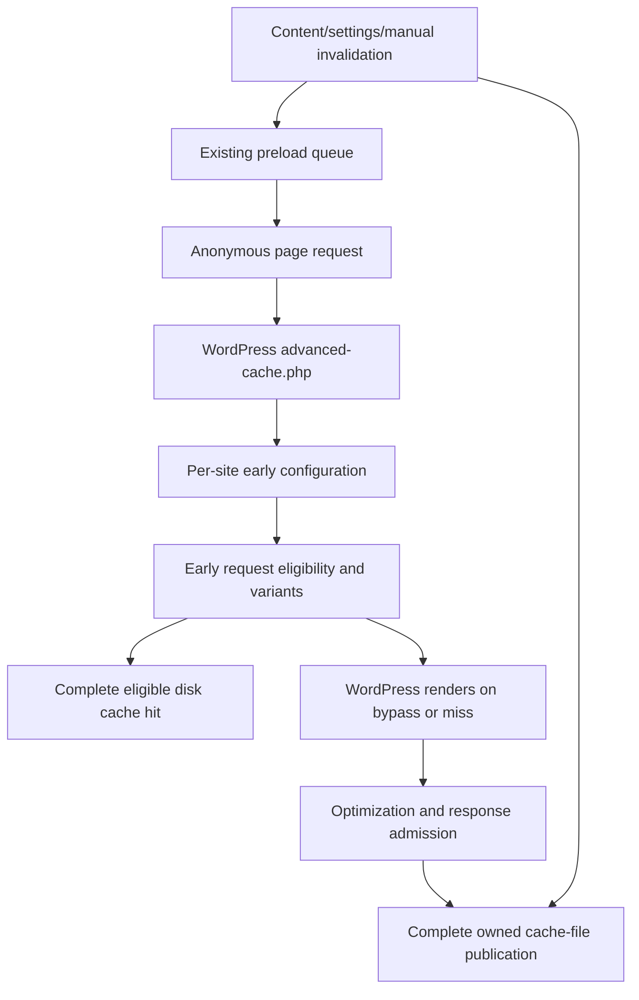
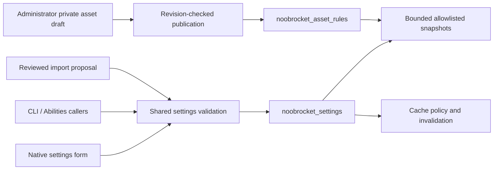

# Architecture and ownership

Cache-Cache uses the inherited WordPress hook/subscriber/container architecture. [Plugin.php](../noobrocket/inc/Plugin.php) registers service providers and activates subscribers through [Event_Manager](../noobrocket/inc/classes/event-management/class-event-manager.php). Trace registration, not filenames alone: some inherited cloud/license/monitoring classes remain present while their service paths are disabled. No new provider, context or interface is required merely because a feature is added.

## Request and page-cache path

| Responsibility | Maintained owner | Contract |
| --- | --- | --- |
| Bootstrap, product constants and activation | `noobrocket/noobrocket.php`, `inc/Plugin.php`, `inc/functions/` | Preserve plugin path, data identifiers and shared drop-in ownership. |
| Early loader and per-site configuration | `inc/Engine/Cache/AdvancedCache.php`, `Config/`, `inc/classes/Buffer/class-config.php` | Only an explicitly owned `advanced-cache.php` may be replaced. Early config is executable policy. |
| Early eligibility, response admission, variants and publication | `inc/classes/Buffer/class-tests.php`, `class-cache.php`, `class-abstract-buffer.php` | Public anonymous responses only; complete files, scheme/device/cookie/query rules and privacy headers remain authoritative. |
| URL/content invalidation | `inc/Engine/Cache/Purge.php`, `UrlValidation/`, `inc/functions/files.php` | Purge affected archives/pagination and old/new URLs; preserve unrelated cache owners/sites. |
| Expiry and optional stale refresh | `inc/Engine/Cache/PurgeExpired/` and early buffer policy | Full-tree scanning remains proportional to owned files. PHP enforces the stale hard cutoff; direct static HTML cannot. |
| Preload discovery, admission and completion | `inc/Engine/Preload/Frontend/`, `Controller/`, `Database/`, `Cron/` | Native queue normalization, pending/running deduplication and usable required variants determine completion. Activation queues work. |

The early hit bypasses normal plugin boot. PHP hits expose `Cache-Status: NoobRocket; hit`; static Apache/Nginx delivery uses server rules and does not execute that header path. Publication locks prevent competing file writers from publishing partial output; they do not serialize all cold WordPress renders.

## Settings and admin transactions

`inc/Engine/Admin/Settings/Page.php`, `Settings.php`, `Render.php` and views own native page structure and fields. `inc/admin/options.php` applies shared domain checks and save effects; `inc/admin/admin.php` owns staged import/review. Imports preserve site keys/version markers and reject stale proposals. `inc/Engine/Abilities/Options/` owns the supported option allowlist.

`inc/Engine/Optimization/Assets/Rules.php`, `Admin.php`, `Frontend.php` and `Snapshots.php` own dependency-safe asset rules, private inspection/drafts, publication and five-entry settings history. Saved settings, private drafts and public asset publication are separate operations. History excludes credentials and restores allowlisted settings/rules; it cannot recover deleted database rows. Native locking and revision checks belong to those owners.

The shared settings JavaScript, admin styles, views and enqueues own Save/Cancel, navigation, appearance and feedback. [Design guidelines](../tools/DESIGN_GUIDELINES.md) are the sole design contract. [PageSpeed.php](../noobrocket/inc/Engine/Admin/PageSpeed.php) owns the optional manual external lab request and its separately stored key/results; lab scores are not cache coverage.

## Optimizers, workers and queues

| Area | Owner and boundary |
| --- | --- |
| Buffer transformations | `inc/Engine/Optimization/Buffer/`, `Minify/`, `DelayJS/`, `DeferJS/`; preserve original output when selected resources cannot be safely transformed. |
| Local critical/used CSS | `inc/Engine/Optimization/LocalCSS/Jobs.php`, `Frontend.php`, `Subscriber.php`, `Diagnostics.php`; existing per-site used-CSS table holds separately named local queues. Fingerprints/claims/leases reject stale publication. |
| Same-server CSS execution | `noobrocket/local-css/worker.mjs`, `generator.mjs` and PHP bridge; unprivileged Chromium samples public pages. Explicit origins constrain browser requests. See [worker setup](../noobrocket/local-css/README.md). |
| Modern images | `inc/Engine/Media/Picture/Generator.php` and `Subscriber.php`; bounded cron generation with owned outputs and AVIF/WebP/original picture delivery. Original files remain available. |
| Font preparation | `inc/Engine/Media/Fonts/`; local font ownership stays with the font controller. Cold preparation has a bounded synchronous budget, not a demonstrated zero-cost path. |
| Next-page preparation | `inc/Engine/Preload/Links/` and its enqueued script; intent-driven rules prepare one eligible destination. Fixed dynamic eagerness is current behavior; configurable document-rule eagerness is not implemented. |
| Providers and object cache | `inc/Addon/`, `inc/Engine/CDN/`, `inc/Engine/Cache/ObjectCache/`; saved authorized provider operations and existing-provider diagnostics, without installing a second object-cache drop-in. |

WordPress cron/Action Scheduler and existing native queues own scheduling. Local CSS has one lease per site; mutating fixtures run serially. Multisite workers explicitly select a site before accessing its queue/settings/files. Do not replace these paths with a general scheduler to solve a bounded defect.

## Persistent ownership and recovery

Defaults are `wp-content/noobrocket-config/` and `wp-content/cache/noobrocket/` with `pages/`, `min/`, `busting/`, `critical-css/` and `used-css/` below the cache root. Constants allow existing configured paths; inspect the effective runtime before deleting anything. `noobrocket_settings`, asset rules, private user metadata and bounded history have distinct owners. Database tables retain the `nbr_` family and site prefix.

Product updates refresh compatibility lists and invalidate page/minification caches; engine migrations run when the independent engine marker changes. Deactivation preserves settings; uninstall is destructive and site/network-aware. [Operations](operations.md) distinguishes code rollback, settings restore and database recovery. [Source inventory](source-inventory.md) tracks confirmed open findings separately from historical fixes and verification limits.
