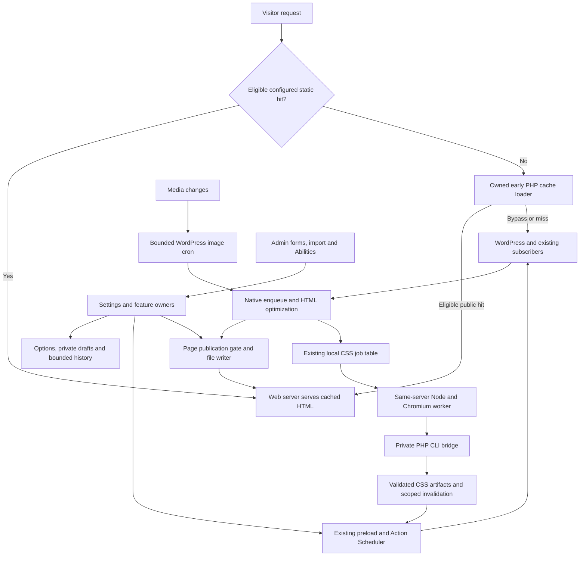

# NoobRocket full-system review — 2026-10-09

The existing architecture can support a well-designed, fast WordPress plugin. Keep it. The current build has confirmed correctness, workload and interaction gaps; it is not ready for a claim of being fully optimized or better than WP Rocket. Fix ownership and fallback first, then measure and reduce the work that matters.

This document preserves the pre-fix review and proposal. Its findings, counts and open-state wording describe that review checkpoint. The approved implementation and resulting verification are recorded in [the current batch report](batches/BATCH_FIXES.md); use that report for current status. Maintained source is NoobRocket 1.3.1, with inherited engine version 3.23.5.1. The review itself performed no product fixes, packaging, commit, push or deployment. The [ordered improvement plan](IMPROVEMENT_PLAN.md) retains the original work and acceptance criteria.

## Scope and evidence

The review traces active registration, request flow, storage ownership, failure handling and representative invariants across caching, settings, lifecycle, providers, CSS/JS, media, jobs and every admin page. It combines source inspection, isolated native-method probes, existing focused checks and the fresh WordPress card audit. It is not a claim that every line of every bundled dependency received a manual audit.

| Domain | Detailed current report | What it establishes |
| --- | --- | --- |
| Composition, settings, import, publication, history, lifecycle and authorization | [Architecture review](audits/FULL_REVIEW_ARCHITECTURE.md) | AR01–AR10, active/dormant distinction, ownership, isolated reproductions and compatible corrections. |
| Cache delivery, publication, invalidation, preload and backend load | [Cache review](audits/FULL_REVIEW_CACHE.md) | CACHE-01–09, privacy/publication boundaries, queue mechanisms and profiling requirements. |
| Visitor resources, transformations, image/font generation and workers | [Optimization review](audits/FULL_REVIEW_OPTIMIZATIONS.md) | OPT-01–19, reproduced failures, bounded-work gaps and measured-first proposals. |
| Cloudflare/Sucuri and separate PageSpeed/image actions | [Provider boundary review](audits/FULL_REVIEW_PROVIDERS.md) | PROVIDER-01–05, source-confirmed credential/invalidation/target gaps and retained native action boundaries. |
| All 14 admin routes and their cards | [Card-by-card audit](CARD_BY_CARD_AUDIT.md) | Shared SH01–08, per-card evidence, workflow correctness and visual/interaction proposals. |
| Existing conventions and performance protocol | [Design guidelines](DESIGN_GUIDELINES.md), [benchmarks](BENCHMARKS.md) | Preserve working conventions; historical results do not establish current correctness or speed. |

Evidence vocabulary:

- **Observed:** current browser output or an interaction was inspected.
- **Reproduced:** native product methods were exercised in an isolated fixture. A passing reproduction assertion confirms a defect, not a correct product.
- **Source-confirmed:** an active path establishes the behavior; production prevalence or timing was not measured.
- **Proposal:** a traced opportunity requiring profiling or compatibility proof before implementation.
- **Dormant:** a method/template exists but no current registration reaches it. Do not promote it to an active user defect.

The complete packaged tree contains 1,679 files and 24,743,776 bytes excluding worker `node_modules`. The initial SHA-256 inventory covered 1,673 files; final comparison exposed six pre-existing dot-path vendor/reference files omitted from that inventory. Their observed timestamps precede the baseline, but their content has no initial hash. Syntax proof covers 1,413 PHP and 37 JavaScript files, including bundled PHP dependencies; the six omissions contain no PHP/JavaScript. These counts describe inventory and parsing, not exhaustive behavioral coverage. The workspace has no Git repository.

## Architecture to retain

Keep WordPress hooks/subscribers and the existing container. Keep public anonymous disk hits outside full WordPress bootstrap, per-variant atomic page writers, native capabilities/nonces, conservative originals, recursive enqueue-dependency protection, bounded image jobs and the existing queues. Keep the CSS worker local, serial and sandboxed, with its CLI bridge and lease. None of the confirmed gaps requires a new cache service, queue daemon, SPA or generic transaction framework.

Important boundaries need correction:

- An early private hit must validate the real WordPress session. A companion username signature is not that validation.
- A successful transformation is not proof of successful page publication or warm-up.
- Settings normalization must not dispatch destructive work. Confirmed operation scope and committed settings are different responsibilities.
- An action must apply the private draft/current state that its review described.
- An optimized URL must identify a complete usable artifact; failed preparation retains original delivery.
- Background work is only bounded if its individual tasks and retry policy are bounded.
- Static Nginx delivery bypasses PHP policy checks. Supported background stale refresh requires PHP routing and disabled direct Nginx page-cache rewrites; its hard deadline is not enforced on static hits. Ordinary static mode still needs matching ownership/bypass rules.

## Correctness before speed

P1 findings below belong in the first implementation batches. CACHE-04 is P2 in its domain report but should accompany the owned-filesystem corrections. These are conditional/integration defects; no live leak, destructive operation or attack on the user's site was performed.

| Finding | Evidence and consequence | Smallest fitting correction |
| --- | --- | --- |
| CACHE-01: authenticated early hits trust a companion without validating the native session | Reproduced with a valid companion and invalid/expired native cookie; User Cache defaults off. | Deliver private cache only after native authentication; bypass private early hits until supported. Preserve public early hits. |
| CACHE-02: public publication ignores explicit response privacy headers | Native HTTP gate accepted anonymous HTML with `Cache-Control: private, no-store`. | Respect explicit privacy directives in the existing publication gate; define opt-in User Cache separately. |
| CACHE-03 and CACHE-04: executable policy publication and host purge ownership | Empty/truncated policies and sibling-host selection reproduced. | Atomic owned policy/drop-in publication, fail-closed incomplete policies and exact owned directory selection. |
| AR10: plugin deactivation exceeds delegated performance-management authority | An isolated active endpoint reaches an unrelated target with only the plugin's management capability. | Namespaced action, target-bound nonce, intended conflict validation and native per-plugin capability at UI/endpoint. |
| AR01 and AR02: publication/restore can differ from the displayed review | Two-tab private replacement and an intervening saved-setting change reproduced. | Expected draft revision and bounded current-state review in existing owners/lock; preserve work on conflict. |
| AR04 and AR05: domain validation and write outcomes differ by entry point | Invalid CDN/API values and false success reproduced; import outcome gap traced. | Reuse settings-owned normalizers across form/import/API, preserve partial-update semantics and verify normalized saved state. |
| AR03, OPT-03 and OPT-06: cleanup timing, scope and task bounds | Pre-commit dispatch and foreign-table optimization reproduced; full-category loops traced. | Explicit scoped native cleanup action, current-site permitted tables and resumable chunks in the existing process. |
| OPT-01 and OPT-04: failed/error resource preparation becomes a published artifact | Failed font write and HTTP 503 body persistence reproduced. | Validate preparation before rewriting/persisting; preserve original URLs and bounded network fallback. |
| OPT-02: delayed JavaScript breaks under enforcing CSP | Real Chromium original/optimized comparison; optimized application script remains inert after click. | Conservative original-script fallback under unsupported enforcing policy; preserve policy strength. |
| OPT-05: LRC beacon fails to enforce its declared hash limit | Allowed-context controller stores 40 entries despite cap 20; registration and context gates traced. | Bound input and accepted unique entries in the existing controller. Do not imply every installation enables the feature. |
| PROVIDER-01–02: Sucuri failure logs can contain credentials; Cloudflare internal purge can skip cron | Source-confirmed, debug-enabled Sucuri error logging and configured Cloudflare Cache Everything Page Rule synchronization. | Redact credential-bearing log context; authorize trusted internal synchronization at its hook owner while preserving manual endpoint capability/nonce checks. |
| AR08: current CDN regression fixture fails before assertions | Executed exit 1: missing prerender sanitizer helper in fixture bootstrap. | Repair the focused fixture before relying on it. This is not a real WordPress save failure. |

The reports also document pre-commit history retention, uninstall omissions, inaccurate preload completion, queue running-state bookkeeping, automatic discovery ownership and CSS retry/freshness/invalidation gaps. Their details remain in one domain report rather than being repeated as separate new findings here.

Provider corrections also include preserving a prior zero TTL, using the explicitly validated target zone for a save, and matching a site to its actual zone boundary rather than a substring. The separate PageSpeed key/result actions and modern-image backfill have native POST/capability/nonce boundaries; those are worth retaining. Provider source review did not call external services or establish current Cloudflare/Sucuri API availability or compatibility.

## Admin frontend and maintainability

The native admin does not need a replacement framework. Its two styling layers and bundled legacy script need clearer responsibility and a reproducible maintenance path.

| ID | Current evidence | Proposal and limit |
| --- | --- | --- |
| ADM-01 | `assets/js/noobrocket-admin.js:366–417` rebuilds full `FormData` and changed-field/section descriptions at least three times per Save-state event. Labels are repeatedly searched/cloned. | Compute one change description per event and pass it to existing rendering/summary functions. Retain dynamic CDN rows, masked fields and change ordering. Measure input/update latency first and after; no state library. |
| ADM-02 | `noobrocket-settings.js` is a 5,477-line Browserify bundle. Served minified settings JS is 140,484 bytes; admin JS 36,428; common JS 1,814; appearance JS 1,727; MicroModal 7,102. Legacy warning code still uses GSAP. | Recover/document reproducible editable inputs and generation before coherent pruning. Remove proven dormant slices; do not delete GSAP merely by size. Internal original module names in a bundle are not maintained source files. |
| ADM-03 | Served minified settings CSS is 123,707 bytes; admin CSS 62,374. Confirmed checkbox, disabled-button, radio and movement conflicts cross their owners. | Consolidate at shared components and remove the conflicting legacy rule. Synchronize source/generated assets; avoid another override layer. File bytes alone do not prove load cost. |
| ADM-04 | All 14 panels render together. Baseline EN response is about 277.5KB/2,701 DOM elements; FR about 289.3KB/2,702. Section construction includes database-category counts even on unrelated routes (`Page.php:234,1237–1241`). | Profile render SQL/time and startup/input work. Defer costly evidence/counts through existing feature ownership if material; preserve shared form values/navigation. These are uncompressed response/DOM sizes, not measured speed regressions. |
| ADM-05 | Small common JS/CSS are enqueued throughout WordPress admin (`inc/admin/ui/enqueue.php:56`). Main settings assets are correctly page-scoped; appearance loads early. | Scope common assets only after enumerating active notices/actions. Low priority because payload is small. Preserve dismissal, no-JavaScript recovery and early theme application. |
| ADM-06 | Composer scripts refer to absent maintained upstream tests/runners; `tools/build.py` verifies archive CRC but no checks/catalog/generated-input gate. No reproducible admin bundle regeneration command was found. | Document actual root tests, establish source control locally and verify release inputs separately from ZIP generation. Package only when design/validation are complete and requested. |

Paths in this table are relative to `noobrocket/` unless prefixed `tools/`. The old Safe Mode subscriber and Wistia enqueue method are dormant in the current registration map. Their presence does not establish a current external request or active recovery feature. The local CSS table and compatibility code still have real uses; do not remove them based on inherited names.

## UI: improve every task, not card symmetry

The current light/dark palettes and system typography can stay. All pages share useful structure. The unresolved problem is state visibility, task flow and uneven density. No score is assigned; automated passes cannot justify a beauty or usability rating.

| Page | Next correction, with full card evidence in the linked audit |
| --- | --- |
| Overview | Truthful off/paused/empty queue wording, image readiness, compact evidence and one next action per status. |
| Preload | Keep warming progress with its setting; explain prefetch/prerender/fallback once. |
| Cache rules | Group exclusions/purge/query policies; show refresh eligibility beside the selected lifespan. |
| CSS & JavaScript | One visible radio indicator; setup/requirements before exceptions; concise feature consequences and recovery. |
| Media | Consistent generation/navigation footer; flatten the small video child option; retain font grouping. |
| Asset Manager | Complete short rule lists, editor-local errors, clear asset selection, reviewed preview/publication state and compact unchanged state. |
| CDN | Rewrite purpose, saved-scope verification sample and narrow URL layout. |
| Integrations | Compact provider/compatibility headings and switches; distinguish pending configuration from saved readiness. |
| Cloudflare | Nearby labels/fields/key-acquisition links; concrete provider effects and identifiable field errors. |
| Sucuri | Same credential/action rhythm and clear saved readiness. |
| Heartbeat | Keep native context choices; shorten prose while retaining editor/autosave consequences. |
| Database | Category/count-first scan, immediate action next to scope and clear recurring scope. Backend safety precedes layout. |
| Settings history | Recognizable compact summaries, meaningful differences and current-state-bound restore. |
| Tools | Active import review first, neutral review surface, readable choices and transfer-related navigation. |

Shared corrections: visible native checked markers in light mode, authoritative disabled state, one radio indicator, in-place Cancel with dynamic-row restoration, stationary hover/focus bounds and one help/navigation-placement rule. The fresh browser audit confirms Cancel reloads; it does not establish a theme flash. Keep icons/navigation and the user-requested hidden sidebar scrollbar. Related cards need a consistent vocabulary, not identical heights or empty padding.

Standalone operation outcomes already have a persistent tray. Keep local field/review errors at their owner and validate semantic severity, keyboard clearance, dismissal and no-JavaScript visibility when changing feedback. Do not convert every message into a toast or reopen the notification system without evidence. Keep gettext message keys in source and translations in PO/MO.

## Speed: distinguish the paths

| Path | Main opportunities | Evidence required |
| --- | --- | --- |
| Warm static/PHP public hit | Correct bypass/stale contract, cache coverage, exact invalidation and existing gzip delivery. | Proven hit state, variant, TTFB, hit ratio and policy correctness. Bootstrap refactors do not speed up a hit that bypasses WordPress. |
| Cold/public or uncached render | Resource fetch failures/timeouts, font preparation, repeated settings/graph/filesystem work. | PHP/SQL/filesystem profile, remote time, cold TTFB and unchanged markup/behavior. |
| Background generation | Bounded refresh admission, scheduler queries, resumable cleanup, retry caps, scoped CSS invalidation. | Host CPU/memory, queue age, actions/job, task duration and visitor p95 during work. |
| Browser initial render | Smaller useful image variants, effective CSS payload, correct LCP/lazy-loading policy and working delayed scripts. | Compressed wire bytes, FCP/LCP/CLS, failed resources and tested interactions across templates/widths. |
| Subsequent navigation | Existing intent-based Speculation Rules and prefetch fallback. | Activation/normal navigation, exclusions, side effects and bandwidth. This feature already exists; do not add a duplicate. |
| Admin | One-pass change descriptions, measured section evidence and coherent assets/components. | Render SQL/time, startup scripting, input latency and actual EN/FR light/dark task review. |

Do not optimize by enabling every switch, increasing parallel preloading or sacrificing dynamic CSS safety. Native image generation can produce a larger derivative, so compare bytes and preserve complete responsive fallback families. Narrow CSS invalidation only after proving all affected routes remain fresh. A preload table index needs native MySQL/MariaDB EXPLAIN before a migration. Browser lab latency is not field INP.

The matched Noobunbox comparison on 2026-10-08 found near-equivalent warmed static-cache behavior with CSS generation off. Later optimized theme/settings profiles are different conditions. Neither proves current universal superiority. Use the [existing benchmark protocol](BENCHMARKS.md) and the plan's decision gates.

## Verification and limits

| Fresh check | Result | Meaning |
| --- | --- | --- |
| Packaged-source syntax | PASS: 1,413 PHP, 37 JS, zero parse errors. | Parsing only; PHP 8.3.35/current installed Node. |
| Cache fixtures | PASS: 13 writer, 10 config, 8 preload assertions. | Existing isolated contracts; new privacy/policy/ownership defects reproduced separately. |
| Architecture fixtures | PASS: import 14, asset/history 26, uninstall 638 assertions. | Existing in-memory/lifecycle contracts; not real concurrent database writes. |
| CDN validation fixture | FAIL before assertions, exit 1. | Missing helper bootstrap, AR08; temporary review shim is not a maintained fix/pass. |
| Optimization fixtures | PASS: bloat/object cache 38; image generator 31; link PHP 113 + 6; CSS generator 47; CSS interactions 18; link browser 180. | Isolated native/Chromium contracts; no real installed commerce/theme matrix. |
| Admin fixtures | PASS: appearance 405, transactions 71, CDN browser 162. | Synthetic forms; these passes do not close the current native WordPress control defects. |
| Native UI audit | 448 route/render records, 70 configurations, 1,526 card tiles; ten shell states and 28 interaction records. | All 14 routes, both themes and EN/FR with conditional/narrow cases; confirmed defects remain. Tile counts are not independent usability trials. |
| Worker dependency advisory check | Zero registry-reported advisories, `npm audit --omit=dev`, exit 0. | Current pinned worker graph only; no full PHP dependency/security audit. |

Detailed command receipts and reproduction limits are in the domain reports and [test record](../tests/README.md#full-system-review--2026-10-09-documentation-only). Syntax/inventory/preservation proofs live in [the review evidence directory](../.artifacts/full-review-20261009/). Fresh UI fixture cleanup confirms protected runtime state was preserved.

Remaining release proof: real minimum/current PHP and WordPress, native Linux PHP-FPM/Nginx/Apache/MySQL/MariaDB, mapped-domain multisite, current commerce/page-builder behavior, real encoder capacity, real concurrency and database write failures. Earlier Linux records are historical and do not certify this current source. PHPUnit/PHPStan were unavailable in the maintained workspace. No new site-speed/load benchmark, manual screen-reader study, full RTL/no-JavaScript task matrix or exhaustive dependency audit is claimed.

The review's [source-preservation receipt](../.artifacts/full-review-20261009/source-preservation.json) confirms exact path/byte/hash equality for all 1,673 initially inventoried files, with the six-file baseline omission explicitly recorded. No product edit was performed. Review documents and owned evidence are the deliverables. Implementation requires completing and verifying the individual plan batches; none is marked fixed here.
