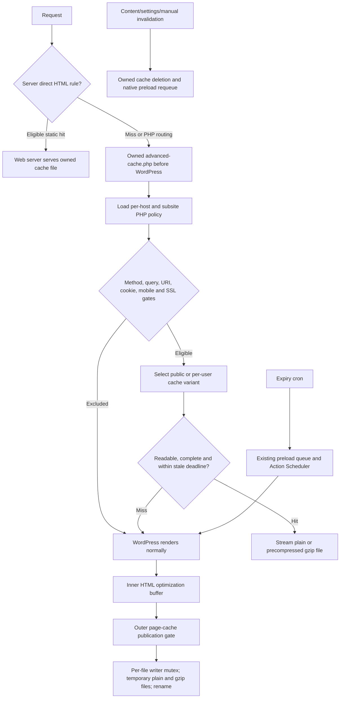

# Cache delivery and backend speed review — 2026-10-09

Current maintained source: NoobRocket 1.3.1. Read-only product review; no plugin changes, WordPress mutations, real purge, live traffic test or deployment. Historical [code review](../CODE_REVIEW.md) and [benchmarks](../BENCHMARKS.md) provide context, not proof that today's source is fast or defect-free.

## Behavior and ownership

The early-hit boundary lives in `noobrocket/views/cache/advanced-cache.php:93`, `inc/classes/Buffer/class-tests.php:185`, `class-config.php:113` and `class-cache.php:89`. It intentionally runs without WordPress database access. Keep this public anonymous fast path. Logged-in delivery needs stronger authentication than the current username companion check.

Background refresh is conditional: preload enabled, nonzero lifespan, legacy WebP cache variants off and no mandatory/dynamic cache cookies (`inc/functions/files.php:75`). PHP limits canonical public stale files to one hour beyond TTL; query, dynamic and per-user variants do not receive that grace (`class-cache.php:205`). Apache direct HTML delivery is omitted for this mode (`inc/functions/htaccess.php:262`). Nginx is an operator-managed boundary: the bundled [cache guide](../../noobrocket/docs/index.html#cache) correctly requires disabling static page rewrites when enabling PHP stale refresh. A Nginx static hit bypasses PHP deadlines and gates.

Object-cache integration owns diagnostics, not a replacement Redis/Memcached provider (`inc/Engine/Cache/ObjectCache/Diagnostics.php:40`). It probes a random short-lived owned key and removes it, preserving foreign drop-in ownership. Normal public disk hits do not perform this health probe.

## Retain

- Anonymous hits stream existing gzip rather than recompressing each request; explicit gzip refusal is respected (`class-cache.php:175`, `:239`).
- Files are opened and checked before delivery, including size, gzip signature and current file mtime. Purge races can fall back to rendering (`class-cache.php:239`).
- Publication uses a nonblocking OS mutex and temporary files; complete files replace prior bytes. A failed gzip publication removes its older companion. The writer lock prevents overlapping publication, not all duplicated WordPress renders on a cold miss (`class-cache.php:377`).
- Reuse native Action Scheduler uniqueness, preload queue, WordPress request API and existing per-site ownership. Pause preserves pending work; mobile and HTTPS variants are distinct (`Preload/Controller/PreloadUrl.php:63`, `:323`).
- Native content invalidation remains immediate. Stale grace is for TTL expiry, not a blanket exemption from content updates.
- Existing CSS-worker backpressure lowers the native preload maximum to five while a recently active worker runs (`Optimization/LocalCSS/Diagnostics.php:233`). Extend that existing control if measurement warrants it.

## Ranked findings

Paths below are relative to `noobrocket/`. P1 means correctness/privacy first; P2 means targeted reliability or scale; P3 means clarity or smaller polish. Performance effects are mechanisms, not measured gains.

### CACHE-01 — P1: authenticated early hits do not validate the native session

**Confirmed by source and isolated probe.** `inc/classes/Buffer/class-cache.php:596` extracts only the username from `wordpress_logged_in_*`; `:643` checks a companion signed over username and expiry. `UserCacheKeySubscriber.php:45` receives WordPress's session token but does not bind the companion to it. Issuance checks genuine authentication, and ordinary logout clears the browser companion, which are useful protections. An old copied companion still validates until its own expiry, however; the early hit does not ask WordPress whether the supplied authentication cookie/session is valid or revoked.

The probe passes a valid future companion for a synthetic user together with `alice|1|invalid-session-token|invalid-auth-mac`. The initial request gate succeeds and `get_cache_path()` selects Alice's bucket. This is not an arbitrary unsigned-user bypass: a valid companion is required. User Cache defaults off (`inc/admin/upgrader.php:93`); anonymous delivery does not need the extra auth path.

**Smallest fitting correction:** move authenticated cache selection/delivery after native WordPress authentication and use `wp_validate_auth_cookie()` and the authenticated current user. Keep anonymous early hits. If that integration cannot be completed safely in one patch, bypass authenticated early delivery until it can. Native session validation is preferable to a second session registry or revocation sidecar. Do not invent a new auth service to preserve a premature private fast path.

**Impact:** privacy correctness; authenticated hits incur WordPress/authentication bootstrap cost. Default anonymous hits remain fast.

**Acceptance:** valid session hits the correct per-user bucket; modified/expired/revoked cookies and destroyed sessions cannot read or publish private cache; logout, password change, multisite and common-user-cache behavior are verified in isolated native WordPress. Record authenticated TTFB after the fix rather than claiming it remains equal to anonymous delivery.

### CACHE-02 — P1: explicit response privacy directives do not stop public publication

**Confirmed by native HTTP gate probe and source.** `inc/classes/Buffer/class-tests.php:315` checks response status, the opt-out constant, 404/search and HTML; it never reads `Cache-Control`. `class-cache.php:291` then calls the default-enabled generation filter and publishes. An isolated PHP HTTP server sent real `Cache-Control: private, no-store` for an anonymous 200 HTML response; the buffer gate returned true.

This is an integration boundary: a plugin that already supplies `DONOTCACHEPAGE` or an exclusion remains protected. No leak on the user's site was tested or asserted. Existing cached pages must still be invalidated if a site changes their cache policy; a response-time gate cannot inspect headers that WordPress has not generated on a disk hit.

**Smallest fitting correction:** respect explicit private/no-store directives before public page-cache publication at the current gate. Keep harmless ordinary cookies separate from this check; blanket `Set-Cookie` rejection would disable unrelated public pages. Define and test the deliberate User Cache contract separately, since WordPress's own logged-in nocache headers interact with that opt-in feature. Avoid introducing a universal HTTP middleware layer.

**Impact:** privacy correctness; explicitly private public responses render normally instead of receiving a shared hit.

**Acceptance:** public, private, no-store, mixed-case/multiple Cache-Control headers and absent headers tested through native HTTP; headers from a late plugin hook are honored; public pages with harmless cookies keep working; private routes already present in cache are purged on a policy change.

### CACHE-03 — P1: executable cache-policy files are replaced in place

**Confirmed file-state defect; race frequency unmeasured.** `inc/functions/files.php:247` regenerates each PHP policy by calling `noobrocket_put_content()` (`:1343`). Native `WP_Filesystem_Direct::put_contents()` opens the target with `wb`, truncating it before writing. `Buffer/Config::get_configs()` includes that file directly (`class-config.php:128`). The existing missing-file guard is good but does not validate completion.

Fresh probes establish both hazardous intermediate states: an existing empty file is accepted as a configuration containing permissive defaults, admitting a normally excluded session/URI; a partially written PHP statement throws `ParseError`. They reproduce intermediate states, not the probability or duration of a production concurrent write. The same direct helper writes `advanced-cache.php`; audit that executable replacement boundary together.

**Smallest fitting correction:** publish generated PHP policy/drop-in bytes through a temporary file in the same owned directory and successful rename; preserve old bytes on failure. Invalidate relevant OPcache entries where required by the deployment contract. Add a clear generated completeness marker or required-field validation so an existing malformed/empty policy fails closed. Use a narrowly owned helper for these executable files, not a global filesystem adapter rewrite.

**Impact:** availability and cache privacy during regeneration; no expected steady public-hit speed improvement.

**Acceptance:** concurrent readers see a complete old or new policy; empty/malformed/incomplete files bypass safely; disk-full/write/rename failure preserves valid old file; Linux and Windows replacement behavior verified; no foreign drop-in is replaced.

### CACHE-04 — P2: purge directory selection does not establish an exact host boundary

**Confirmed selection defect.** Expiry matching anchors only the start of the hostname (`Cache/PurgeExpired/PurgeExpiredCache.php:256`). An isolated temporary tree selected `example.test.evil` alongside `example.test` and its legitimate user bucket. Manual purge helper `_noobrocket_get_cache_dirs()` embeds the hostname unescaped in a regex (`inc/functions/files.php:1472`); homepage cleanup uses a `host*` glob (`:738`). On a shared cache root, similarly named sibling host directories can therefore be selected by another site's invalidation.

**Smallest fitting correction:** extend existing directory ownership selection to distinguish the exact public host directory and verified user/common-user directories for that site; use that fitting selector for expiry and homepage purge too. Escape literal path/host components. A permissive `host-` prefix alone is not sufficient proof because another legitimate host may begin with those characters. Use the existing site secret/bucket naming contract and preserve multilingual/subdirectory behavior. No new cache catalog is needed.

**Impact:** cache isolation and avoids unnecessary sibling-site misses/rebuilds.

**Acceptance:** exact host and its valid user buckets purge; dot/hyphen-prefix sibling hosts, regex-special hosts and foreign secret buckets survive; current language/subsite preserve rules and Windows/Linux paths remain correct. Run destructive proofs only in disposable trees/sites.

### CACHE-05 — P2: refresh scans can bypass the normal staged preload ceiling

**Source-confirmed scaling behavior; profiling required.** Enabling refresh changes expiry cron to every minute (`PurgeExpired/Subscriber.php:112`). Every run recursively scans the host cache tree (`PurgeExpiredCache.php:299`). Each eligible stale file invokes `refresh_expired_cache()`, which directly enqueues an Action Scheduler action (`Preload/Subscriber.php:412`), outside the ordinary 45-action adaptive staging in `PreloadUrl.php:236`. Plain/gzip/mobile variants repeatedly check uniqueness for the same URL. Uniqueness prevents duplicate active URL actions; it does not cap the number of distinct expired URLs admitted in one scan.

**Smallest fitting correction:** measure actual filesystem walk and scheduler work first. Then use existing preload staging/backpressure for refresh admission and avoid repeated URL scheduling checks within a scan. Bound work per tick only if large-cache profiling proves a problem; retain the hard PHP deadline and fallback to deletion when refresh cannot be admitted. Keep traversal ownership inside the current expiry controller. A new scheduler, cache database or worker service is not warranted.

**Impact:** potential lower background I/O/database spikes and PHP worker competition on large sites. Not a demonstrated TTFB gain.

**Acceptance:** profile 1k/10k/50k owned URLs, fresh versus synchronized expiry, desktop/mobile and compressed pairs; record elapsed time, peak memory, SQL count, admitted actions and public p95 latency during regeneration. Work stays bounded, no eligible route is permanently starved, paused/excluded/private variants remain safe, stale deadline stays enforced without cron.

### CACHE-06 — P2: pending-action bookkeeping hydrates all rows and nests comparisons

**Source-confirmed algorithm; actual scale unmeasured.** `Queue.php:137` queries every pending action as an object with `per_page => -1`. `PreloadUrl.php:281` compares each outdated preload row with each hydrated action. A large action backlog from refresh magnifies object allocation and row×action comparisons. Regular staged preload normally bounds the queue; refresh admission is why this matters beyond that normal bound.

**Smallest fitting correction:** after bounding admission, count actions without loading full objects where native Action Scheduler provides that operation; use one set of active URL arguments for membership instead of the nested scan. Include running actions when evaluating whether work still exists. `Queue::has_remaining_tasks()` currently searches pending actions only (`:104`), so the finish-check flag can clear while the final action is still running (`CheckFinished.php:49`). Do not replace Action Scheduler or add a queue abstraction.

**Impact:** potential lower queue-tick CPU/memory and more truthful completion state.

**Acceptance:** no count query materializes the whole backlog; membership is linear in inspected rows/actions; pending and running actions block premature completion; completed/cancelled actions do not. Use native scheduler and deterministic running-only fixtures, with 10k pending actions on disposable storage.

### CACHE-07 — P2: preload status queries have no matching SQL status index

**Confirmed fresh-schema fact; index proposal requires EXPLAIN.** `Preload/Database/Tables/Cache.php:54` creates primary ID and indexes for URL prefix, modified and last_accessed. It does not create a status/is_locked index. `Queries/Cache.php:340` counts in-progress unlocked rows and selects pending unlocked rows ordered by modified; `:438` counts four statuses. Its comment says the status column is indexed, but the declared SQL schema does not establish that claim. Existing installations may contain external/manual indexes; their database was not inspected.

**Smallest fitting correction:** obtain native MySQL/MariaDB EXPLAIN and timings for the real generated queries at representative row counts. Add one compatible composite index matching the demonstrated pending/count access pattern if it helps. `(status, is_locked, modified)` is a candidate, not an approved migration; verify column widths/index limits across supported servers. Update the misleading comment and existing table migration/version convention. Avoid a speculative ORM replacement or multiple indexes on every column.

**Impact:** potential lower preload/dashboard query work on large sites; extra write/index storage cost must be measured.

**Acceptance:** compare query plans and median/p95 duration before/after on 1k/10k/100k rows; validate migration/idempotence and supported MySQL/MariaDB versions; measure inserts/status updates as well as reads.

### CACHE-08 — P2: completed preload rows describe optimization rather than verified publication

**Source-confirmed state ownership mismatch.** `Preload/Subscriber.php:191` marks a row completed on `noobrocket_after_process_buffer`, emitted by the inner optimization buffer (`Optimization/Buffer/Optimization.php:102`). Actual outer page-cache publication occurs later (`class-cache.php:345`). Generation can be vetoed or the filesystem write can fail after the row became completed; `write_cache_file()` returns no success result. HTTP preload ignores the response result (`PreloadUrl.php:155`). The UI therefore cannot reliably equate a completed row with a generated cache variant.

**Smallest fitting correction:** retain traffic discovery in the optimization hook, but transition a requested preload to success from verified cache publication or the existing native variant-file check. Let the current writer return a meaningful success result at its ownership boundary. Check required desktop/mobile variants and report failed/uncacheable responses through the existing row status; do not add a telemetry pipeline.

**Impact:** reliable warm-cache coverage and recovery; avoids a false finished queue while visitors still pay cold renders.

**Acceptance:** denied generation, failed writes, redirects/errors and uncacheable 200s are not successful warm-ups; existing valid cache short-circuits still complete; both mobile and desktop variants required where configured; a failed warm-up can recover without unrelated full purge.

### CACHE-09 — P3: automatic discovery treats URL substring matches as site membership

**Source-confirmed.** Homepage fallback crawler accepts a link when `strpos($url, $home_url) !== false` (`Preload/Controller/CrawlHomepage.php:69`). A public off-site URL containing the site URL in its path, or a hostname with a suffix, can pass. Sitemap links/children also enter discovery without a native canonical site-host ownership gate (`Preload/Frontend/FetchSitemap.php:65`). `wp_safe_remote_get()` protects private network destinations, but does not make every public off-site URL useful to warm this WordPress cache.

**Smallest fitting correction:** compare parsed scheme/host/port and the selected site's path for automatically discovered page URLs before queuing them. Preserve deliberately configured external sitemap discovery where that is supported, but only preload returned page URLs belonging to the selected site. Reuse the selected home URL; no configurable origin system is required for ordinary page preloading.

**Impact:** avoids unnecessary network/actions/rows; no arbitrary throughput claim.

**Acceptance:** root-relative, absolute, subdirectory, multilingual and multisite links work; hostname suffixes, userinfo tricks, embedded home URL strings, fragments and off-site pages do not enter the site page queue.

## Speed plan and stop conditions

1. Fix CACHE-01–04 before chasing synthetic scores. Establish regression cases first; protect anonymous fast hits and site ownership.
2. Correct warm-up outcome ownership (CACHE-08). A truthful warm cache is a prerequisite for a meaningful performance comparison.
3. Profile expiry/admission, queue bookkeeping and native SQL together (CACHE-05–07). Implement only the smallest bottleneck demonstrated. Reuse current queue, controller, table migration and worker backpressure.
4. Verify server routing: ordinary static Nginx/Apache hit, PHP hit, cold render, TTL refresh and post-update purge are separate profiles. Confirm fresh-connection hit/miss headers and actual current HTML. An independent proxy or Nginx open-file cache can outlive a PHP purge; do not claim PHP code invalidates it automatically.
5. Compare public-site loading on representative homepage/article/archive and mobile/desktop pages using fixed content, settings, network/browser conditions and workers. Record cache delivery proof, compressed HTML transfer, FCP/LCP/CLS and resource failures. Plugin CPU and visitor metrics are separate measurements. Reuse [benchmark tooling](../BENCHMARKS.md).

Warm-cache static delivery already avoids most WordPress/plugin execution. A faster plugin bootstrap primarily helps misses, authenticated pages, admin and background work; it cannot directly improve an already served static hit. Object cache helps dynamic WordPress database work; replacing the existing provider is not a page-cache optimization. Cold-render stampede prevention beyond current writer locking needs real concurrent-miss measurement first. Prefer effective prewarming and bounded refresh before adding visitor-wait locks or another cache index.

No universal performance score, percent faster claim, new mandatory Redis service, new queue backend, speculative Brotli encoder, host-load tuning matrix or blanket shortening of safety checks is proposed. Byte count and line count alone are not speed evidence.

## Fresh proof and limits

Fresh isolated checks on PHP 8.3.35:

| Check | Result | Boundary |
| --- | --- | --- |
| `tests/wordpress-cache-write.php` | PASS, 13 assertions | Actual temporary files and child writer processes; complete final plain/gzip bytes, write failures and released locks. Does not prove two filenames switch atomically together or measure rendering stampedes. |
| `tests/wordpress-cache-config.php` | PASS, 10 assertions | Missing/deleted policy and preview refusal. Empty/incomplete policy are additional unresolved cases reproduced above. |
| `tests/wordpress-preload.php .artifacts/wordpress` | PASS, eight assertions | Loads WordPress classes only; in-memory state/temp cache, HTTPS/mobile selection and pause. Does not load or mutate shared WordPress/database. |
| `.artifacts/full-review-cache/review-probes.php empty-config` | Reproduced | Empty existing config accepted; private URI/session request admitted under defaults. |
| Same probe, `partial-config` | Reproduced | Native PHP ParseError on incomplete included policy. |
| Same probe, `host-boundary` | Reproduced | Expiry matcher selects a hostname suffix sibling. |
| Same probe, `user-cookie-binding` | Reproduced | Invalid/expired native auth with a valid synthetic companion passes initial gate and selects user bucket. |
| `.artifacts/full-review-cache/privacy-probe.php` | Reproduced | Real native HTTP privacy header with accepted buffer publication gate. Owned ephemeral server terminated; no site/database writes. |

Quiet command logs are retained under `C:/Users/Guillaume/.codex/logs/commands/`; successful probe outputs are also directly reproducible from retained artifact scripts. Two initial empty-policy probe failures were fixture diagnosis: the made-up `Audit` user agent matched the inherited `audi` mobile prefix. A normal desktop browser user agent resolves that fixture error. Those failed logs remain retained; they are not product failures.

| Evidence | Retained quiet-log filename |
| --- | --- |
| Writer, 13 assertions | `20261009-213911-827-46fd66c1c0d74a7394439c372757e251.log` |
| Config, 10 assertions | `20261009-213911-847-e0c28539e18949429cea95a04823c306.log` |
| Preload, eight assertions | `20261009-213911-839-3e394b7475e94711a6462e619d948885.log` |
| Empty-policy reproduction | `20261009-213945-765-b7e177a596474e0983f5d1348d84b61e.log` |
| Partial-policy reproduction | `20261009-213911-867-de6007bd28ea45ee999d25d5f79d4667.log` |
| Host-boundary reproduction | `20261009-213911-867-ac2cff9896ec41a1bad062ec0614192a.log` |
| Auth-cookie binding reproduction | `20261009-214242-397-68521e6d55e14535bd06487532afeb9d.log` |
| HTTP response privacy reproduction | `20261009-214242-415-e193948804d448e0bc76fab60af09b6f.log` |

No fresh production timing, native MySQL EXPLAIN, load/capacity profile, full FPM/Nginx matrix, revoked-session WordPress HTTP test or every third-party compatibility test was executed for this subreview. Browser/card findings belong to the separate [card audit](../CARD_BY_CARD_AUDIT.md). This report proposes implementation and acceptance checks; it does not claim the proposals are already implemented.
