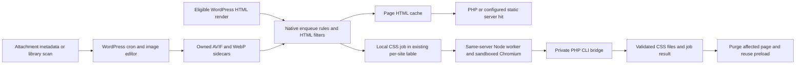

# Visitor optimization and worker review

Date: 2026-10-09. Status: review and improvement proposal; product source unchanged.

Scope: CSS/JavaScript transformation, local CSS worker, image generation/delivery, dimensions, fonts, lazy loading, performance hints, browser link preparation, asset dependencies, Heartbeat and database cleanup. UI proposals belong to the [card audit](../CARD_BY_CARD_AUDIT.md) and the integrated review. This report reviews the current local source. Historical public benchmarks do not establish current performance or superiority over another plugin.

## Architecture and invariants

WordPress owns settings, enqueue dependencies, image encoding and cron. Existing subscribers own feature policy. The output buffer applies transformations when WordPress renders HTML; an early page-cache hit normally skips these transformations. Worker and image work should improve the cached result without moving expensive generation into visitor requests.

| Area | Existing owner and hot path | Invariant to preserve |
| --- | --- | --- |
| Optimization buffer | `Engine/Optimization/Buffer/Optimization.php:87` applies `noobrocket_buffer`; subscriber priorities define order. Dimensions/bloat run at 0; local CSS/picture at 1; CSS minification/LRC at 16; hints at 17; fonts/lazyload at 18; JS minification at 22; defer at 24–25; delay at 26. | Preserve cascade, original fallback markup, exclusions and empty-buffer recovery. Do not replace every pass with a universal parser without a demonstrated need. |
| Asset removal | `Optimization/Assets/Frontend.php:78` and `Rules.php:130` use native enqueue registries and retain required dependencies. | Remove selected roots only; retain dependencies of surviving and already printed roots. Private preview cannot enter shared page cache. |
| Local CSS | `LocalCSS/Frontend.php:43`, `Jobs.php:124`, `Jobs.php:195`. URL eligibility, per-site queue, atomic claims, job token/fingerprint, artifact publication and targeted page purge. | Pending/failed jobs retain originals. Content invalidation rejects stale results. Cookie-personalized, authenticated, query and excluded pages stay outside anonymous sampling. |
| Worker | `local-css/worker.mjs:87`, `generator.mjs:237`, `bridge.php:5`. One reused browser, serial isolated viewport contexts, allowed origins/redirect hops, CLI-only bridge and per-site lease. | Chromium sandbox remains enabled on Linux. No remote job service, application password or public bridge endpoint. |
| Images | `Media/Picture/Generator.php:127`, `Subscriber.php:23`. Cron performs native encodes; HTML uses browser-selected `picture` sources. | Originals/external sidecars retained; responsive family must be complete; one HTML cache works with Nginx. Owned output replacement/deletion requires matching identity. |
| Fonts and dimensions | `Media/Fonts/Frontend/Controller.php:189`, `Media/ImageDimensions/ImageDimensions.php:84`. Filesystem/cache work during uncached HTML transformation. | Retain original remote delivery if local preparation fails; native local fonts stay outside local CSS generation. Dimension inference must retain aspect ratio and existing exclusions. |
| Hints | `Common/PerformanceHints/Frontend/Processor.php:52`; browser beacon feeds existing per-site tables. | First-view sampling must not become recurring expensive work for every warmed visit. Beacon inputs remain bounded and site-owned. |
| Link preparation | `Preload/Links/Subscriber.php:90`, `assets/js/preload-links.js:16`. Intent listeners inject one prerender candidate, with prefetch fallback. | Honor origin/site-root, query/action, core/plugin exclusions, Save-Data and slow-network rules; keep normal navigation working. |
| Heartbeat/database | `Heartbeat/HeartbeatSubscriber.php:55`; `Admin/Database/OptimizationProcess.php:52`. Context settings and existing background-process implementation. | Editor locking/autosave stay operational unless explicitly disabled; destructive cleanup remains scoped and resumable. |

## Retained strengths

- Local CSS reuses the existing per-site table and preload pipeline. Claims and publication use expected tokens; a content edit cannot publish the obsolete result.
- Worker checks every redirect hop, rejects blocked/failed stylesheet/script/font prerequisites, preserves conservative CSS grammar and closes each context in `finally`. Node 22 minimum and four dependencies are pinned in `local-css/package.json`.
- Local CSS does not blindly remove hidden menus, state selectors, keyframes, imported rules, conditional blocks or future grammar. Interaction safelists have real Chromium proof.
- Image encoding already has a four-encode limit, a twenty-second soft deadline, OS locking, owned-file checks and a three-failure stop. It runs outside HTML filters. A completed library scan purges once, avoiding the previous repeated CSS invalidation.
- Picture conversion retains original image attributes, existing pictures, raw-text regions and complete responsive families. This avoids `Accept`-based HTML fragmentation and supports static Nginx page delivery.
- Link preparation already includes real Speculation Rules prerendering. It is not an unimplemented feature. Browser fallback and source/minified behavior have fresh isolated proof.
- Asset removal walks native dependencies. Bloat removal stays opt-in and conservative on block themes, widgets and rendered blocks.

## Confirmed defects and resource gaps

Evidence labels: **reproduced** means native source executed in an isolated fixture; **source-confirmed** means the responsible path was traced without site mutation; **experiment** means a possible improvement requiring measurement. Priorities are consequences and sequence, not a quality score.

### OPT-01 — Failed local font write can publish broken font CSS — P1, reproduced

`Media/Fonts/Filesystem.php:114` ignores `write_file()` failure, then rewrites the URL at line 126 and saves the CSS. A valid downloaded font whose filesystem write fails becomes a nonexistent local URL in a successfully cached CSS file.

Smallest fix: rewrite that font URL only after the file exists/readability and write success are established. Preserve the remote URL for a failed font; do not claim fully local delivery while remote dependencies remain. Publish complete CSS only after its referenced local files are ready. Existing filesystem owner can handle this; no download service is needed.

Acceptance: injected disk/permission failure preserves a working original font URL; no missing local URL appears; a subsequent successful attempt recovers. Metric: correctness, missing resource rate and font-related CLS; no quantified speed claim.

### OPT-02 — Delay JS can disable valid scripts under enforcing CSP — P1, reproduced

`Optimization/DelayJS/HTML.php:148` has no CSP gate. `DelayJS/Subscriber.php:109` inserts an inline delay runtime without a policy nonce. The native transform preserves the original script nonce while making its type inert. Real Chromium proof: an external script runs under `script-src 'self' 'nonce-fixture'` before transformation, but fails to run after clicking the transformed page because the runtime is blocked. Two CSP violations were observed.

Smallest fix: preserve original scripts when an enforcing header/meta policy makes this delivery unsupported. Reuse the existing conservative LocalCSS CSP fallback pattern; do not add a full CSP policy parser or ask operators to weaken their policy. If nonce-aware delay is later required, treat it as a separate compatibility change with inline handlers, `new Function`, modules and data-URL fallback covered.

Acceptance: enforcing CSP retains functional script behavior; report-only CSP does not unnecessarily bypass; ordinary delay/defer ordering, modules, menus/forms and failed resources remain covered. Metric: interaction correctness; delayed execution must not trade first-view scores for broken controls.

### OPT-03 — Table optimization exceeds the current site's database scope — P1, reproduced

`Admin/Database/OptimizationProcess.php:127` selects all non-InnoDB tables with free space in `DB_NAME`; line 131 runs `OPTIMIZE TABLE` without a site/table ownership constraint. `Optimization.php:93` displays the same broad count. A mocked foreign table is actually passed to the native optimization command. This matters for multisite and multiple applications sharing one database.

Smallest fix: enumerate only explicitly supported tables belonging to the current site's permitted scope; make the displayed scope/count and operation use the same enumeration. Quote table identifiers safely. Network-wide maintenance needs its own explicit scope; a subsite cleanup must not imply it. Preserve the existing restriction against indiscriminate InnoDB optimization.

Acceptance: another site's and a foreign application's sentinel tables never enter the command list; selected own tables still work; counts describe the same operation. Metric: ownership correctness and maintenance lock duration.

### OPT-04 — Remote minification cache persists HTTP error bodies — P1, reproduced

`Optimization/AssetsLocalCache.php:59` retrieves only the body from `wp_remote_get()` without validating a successful HTTP response. `get_content()` then persists any nonempty result. Native isolated proof caches the body of a mocked HTTP 503 as a CSS asset. Subsequent transformations can treat an error page as asset content.

Reachability: `Plugin.php:251–252` includes both minification subscribers on ordinary frontend renders (`noobrocket_valid_key()` is unconditional true in this standalone build). CSS and JS `Subscriber::process()` require their respective `minify_css`/`minify_js` option, permit page-level exclusions and honor `DONOTNOOBROCKETOPTIMIZE`. The JS non-combined path calls `Minify::replace_url()` from `Minify.php:99`, then calls this cache for external URLs at lines 206/219; CSS follows the same external-content branch at `CSS/Minify.php:138/152`. Existing readable optimized artifacts bypass the remote fetch. SRI mismatch and configured exclusions can retain the original tag. Thus the defective cache is reached on an eligible uncached external-asset optimization; the isolated proof exercises the shared cache, not a full installed-site JS failure.

Smallest fix: validate the response and return failure for transport/non-success responses; leave the original URL active and retry through the existing cache miss path. Use WordPress's safe HTTP helper, an explicit bounded timeout and an appropriate response-size limit at this existing external boundary. Audit query-sensitive identity: `get_filepath():105` ignores query strings, and minifiers strip queries before fetching; preserve meaningful query variants or conservatively exclude them.

Acceptance: 404/429/503/transport errors are never persisted as optimized assets; valid content still caches; differing query-dependent assets cannot share wrong bytes. Metric: failed resource rate, cold-request TTFB and transfer correctness.

### OPT-05 — LRC beacon's declared hash limit is not enforced — P1, reproduced

`Optimization/LazyRenderContent/AJAX/Controller.php:69` defines a default cap of 20. The loop at line 74 decrements the counter at line 86 but never stops. Native isolated proof stores all 40 valid supplied hashes. Input arrives through the public beacon handler; the existing nonce does not replace payload limits.

Reachability: common plugin subscribers include `performance_hints_ajax_subscriber` and `lrc_frontend_subscriber` (`Plugin.php:352/356`). `PerformanceHints/ServiceProvider.php:77–87` includes `lrc_factory` only when its context allows the feature. That context defaults `noobrocket_lrc_optimization` to true and rejects a truthy standalone option `noobrocket_no_licence` (`LRC/Context/Context.php:16–25`). The AJAX subscriber registers logged-in and anonymous `noobrocket_beacon` actions (`AJAX/Subscriber.php:33–34`); its processor calls each allowed factory's controller (`AJAX/Processor.php:54–55`). Controller nonce/context gates still apply, and an existing URL/device row is not overwritten. The reproduction injects an allowed context and a missing row; no assertion that all installations expose this path or currently suffer large payloads.

Smallest fix: stop after the allowed valid entries and bound input before expensive decoding/iteration; deduplicate accepted hashes. Keep validation in this existing controller. Review peer beacon handlers for the same bounded-input contract with the architecture review.

Acceptance: more than the allowed hashes cannot be stored; malformed/duplicate entries do not consume unbounded work; normal beacon results remain accepted. Metric: request memory, row size and server work; no exploit or live load test was performed.

### OPT-06 — Database cleanup categories are unbounded tasks — P1, source-confirmed

`OptimizationProcess.php:57`, 68, 79, 90 and 101 select every matching ID and delete them in one loop. Transients are similarly enumerated at line 112. Parent background processing checks time/memory only after `task()` returns (`inc/classes/dependencies/wp-media/background-processing/wp-background-process.php:315–323`). A background queue therefore does not bound a large category. Completed counts exist only in the process instance and can lose earlier category totals when work continues in another request.

Smallest coherent fix: use limited keyset batches inside the existing background task, returning unfinished task state with cursor and cumulative counts. Persist those counts with the queue state, and check the inherited limits between deletions. Keep native WordPress deletion APIs and hooks. Do not introduce another queue library or direct bulk deletes that skip WordPress ownership.

Acceptance: a large disposable dataset spans bounded requests, resumes without repeats/skips and reports cumulative totals. Failed/cancelled work is distinguishable from complete. Metric: peak memory, maximum task duration and database load.

### OPT-07 — Permanently failing CSS jobs retry indefinitely — P2, source-confirmed

`LocalCSS/Jobs.php:274` schedules every failure for `time() + 300`; `claim():140` accepts it again with no attempt ceiling or backoff. Deterministic blocked dependencies and unsupported jobs can repeatedly consume Chromium/server resources. The inherited table already contains a `retries` column (`RUCSS/Database/Schemas/UsedCSS.php:86`), so a new retry subsystem is unnecessary.

Smallest fix: increment the existing attempt count, cap automatic retries and use bounded backoff; manual Retry resets the count. Separate stable unsupported conditions from transient fetch failures using a small fixed error category at the generator/bridge boundary. Preserve originals throughout and retain visible recovery.

Acceptance: transient failure can recover; deterministic failure stops automatic work; manual Retry re-enables it; one bad job does not starve newer eligible jobs. Metric: wasted generation time, requests/job and queue completion latency.

### OPT-08 — Manual same-URL stylesheet replacement can leave CSS results stale — P2, source-confirmed

`LocalCSS/Frontend.php:107` fingerprints mode, URL/media manifest and safelist. The generator computes source hashes (`generator.mjs:420`), but `worker.mjs:123` drops them before publication. Ready rows therefore do not recognize changed stylesheet bytes under identical URLs on their own.

Existing theme/plugin upgrades, domain changes and content purges already invalidate CSS (`LocalCSS/Subscriber.php:39–54`). This finding concerns manual/in-place source replacement outside those hooks, not a claim that ordinary upgrades are ignored.

Smallest fix: retain the already computed source identity with the existing result and document the update/invalidation contract. If automatic verification is required, perform bounded revalidation in the existing worker/background path; use versioned asset URLs and normal purge integration first. Do not fetch/hash every stylesheet on warm page-cache hits.

Acceptance: a same-URL source replacement is invalidated/rebuilt through the supported update path; an obsolete worker result cannot publish; unchanged warmed pages issue no freshness HTTP requests. Metric: freshness correctness and regeneration load.

### OPT-09 — CSS invalidation scope causes avoidable browser regeneration — P2, source-confirmed

`LocalCSS/Subscriber.php:48–50` invalidates every CSS job on any term create/edit/delete. `settings_changed():110` uses the broad page options hash. `inc/functions/admin.php:501` excludes many administrative options but still mixes HTML delivery and unrelated configuration. Some full invalidation is intentionally conservative; it is not safe to retain every result on every page purge.

Smallest fix: preserve broad invalidation for theme/plugin/style changes. Reuse affected term/post URLs for proven localized content changes and avoid CSS invalidation for settings shown not to affect sampled markup/style behavior. Keep a short explicit ownership list where it belongs. Do not change ordinary page expiry, which uses its own purge hooks rather than this full-domain hook.

Acceptance: unrelated ready CSS survives a scoped change; changed archive/post/home pages rebuild; theme/global changes still rebuild all; both public cache variants remain fresh. Metric: regenerated job count, CPU and time to optimized warm cache.

### OPT-10 — Modern image conversion does not require a byte saving — P2, source-confirmed

`Media/Picture/Generator.php:256–271` publishes every nonempty encode, and `Subscriber.php:166–174` prefers any readable AVIF sidecar before WebP/original. Neither path compares encoded bytes with source bytes. Some PNG/JPEG images can become larger in AVIF/WebP; the browser still chooses the first supported source.

Smallest fix: publish/use an owned derivative only when it gives a meaningful byte saving at the chosen quality. Decide explicitly how existing external derivatives participate; never delete them to enforce this. Respect complete responsive families. Store the generation outcome in existing attachment metadata so an intentionally skipped encode is not retried forever.

Acceptance: a tiny/poorly compressible source does not acquire a larger preferred variant; beneficial encodes still deliver; fallback, ownership and responsive selection remain intact. Metric: delivered image bytes and image LCP; quality inspection is required and no percentage gain is promised.

### OPT-11 — Cold font hosting blocks visitor response on remote downloads — P2, source-confirmed

`Media/Fonts/Frontend/Controller.php:211` calls the local font writer on a cache miss. `Fonts/Filesystem.php:75` fetches provider CSS and serially downloads missing files at line 106. Slow provider requests multiply uncached visitor/preload TTFB. Warm font files avoid this cost.

Smallest sequence: first fix OPT-01, bound timeout/response size and add a short failure cooldown. Then measure cold font misses. If material, enqueue preparation in existing WordPress background machinery and keep original working links until complete local assets are ready. Do not build a second persistent Node font service.

Acceptance: a delayed/failed provider cannot block for repeated full default timeouts; no broken local links; first fallback and later ready delivery work under CSP. Metric: cold HTML TTFB, remote requests and font CLS; a warm-cache lab result cannot measure this gap.

## Measured-first speed proposals

These proposals have traced cost but no proven site-speed regression. Implement only after the appropriate baseline demonstrates benefit.

| ID / priority | Evidence and opportunity | Smallest approach and decision metric |
| --- | --- | --- |
| OPT-12 / P2 | Critical CSS preserves complete conditional/imported blocks (`generator.mjs:51–60`) and dynamic state rules; ready critical CSS is inline per original sheet (`Frontend.php:145`). This favors correctness but can produce large inline payloads. Historical article benchmarks recorded large inline totals, which also included theme/native font CSS and are not current measurements. | Record original/external/generated/inline/gzip wire bytes per page and first/repeat FCP/LCP. Start with unnecessary safelists and exact duplicate critical blocks. Only refine known conditional-rule selection after multi-breakpoint interaction proof; retain unsupported grammar. Never impose an arbitrary universal critical-CSS size threshold or remove safety to improve a score. |
| OPT-13 / P2 | Worker serially samples up to four normal viewport cases (`Jobs.php:169–189`); it retains captured source/AST/results across samples (`generator.mjs:406`). A stylesheet has a 2 MB bound and 20,000-rule bound, but no page-wide source/rule budget. `--max-seconds` is intentionally checked between jobs. Node resource metrics exclude Chromium/PHP children. | Measure job duration, stylesheet count, aggregate CSS bytes, host CPU and browser memory. Add a simple aggregate CSS/rule budget to the existing generator if needed; retain fallback with explicit reason. Keep serial execution and current lease; use an external service-manager resource budget for actual process limits. Do not add parallel workers until capacity proof. |
| OPT-14 / P3 | Each job invokes the WordPress/PHP bridge for claim, complete/fail and worker update (`worker.mjs:112–138`), with fresh WordPress bootstrap per call (`bridge.php:44`). | Profile bridge time before altering ownership. If significant, combine result/status updates into the existing bridge command. Avoid a persistent custom PHP daemon or new IPC protocol. Metric: WordPress bootstrap CPU/job and total queue throughput. |
| OPT-15 / P3 | Asset rules validate and walk the dependency graph at four native enqueue/print phases (`Assets/Frontend.php:23–26`). Empty published rules still enter two graph traversals. Bloat performs separate conservative dependent checks. | Add an empty-rule fast path and reuse immutable validated rules within the request, while re-reading the actual queue each print phase. Keep late-enqueue coverage. Consolidate dependency traversal only if both feature owners can express the same invariant clearly. Metric: uncached PHP time with empty/100-rule sets and late enqueue correctness. |
| OPT-16 / P3 | Dimensions recheck local existence and read image headers for each missing-dimension tag (`ImageDimensions.php:408–480`); picture delivery resolves each candidate/format separately (`Picture/Subscriber.php:138`). | Request-local memoization of repeated URL/path lookups is sufficient if profiling shows repeated images dominate. Prefer existing attachment dimensions where unambiguous. Keep external dimension fetching opt-in/off by default; no new persistent dimensions service. Metric: cold page filesystem calls, PHP CPU and unchanged CLS behavior. |
| OPT-17 / P3 | Missing hints rows inject a 26,015-byte minified beacon; it may POST a check from still-cached HTML (`PerformanceHints/Frontend/Processor.php:69–83`, `noobrocket-beacon.js:1501`). Font analysis can traverse elements and refetch inaccessible CSS. ATF/LRC/preconnect are enabled through existing context filters, not all exposed as independent settings. | Measure cold/warm beacon transfer, long tasks and AJAX request rate before removing helpful hints. Stop injecting once all relevant native results exist. Make enabled/collecting/ready/failure state understandable in existing UI; keep a supported opt-out. Metric: extra requests, browser scripting time and LCP benefit from generated hints. |
| OPT-18 / experiment | LRC emits `content-visibility:auto` without an intrinsic-size reservation (`LRC/Frontend/Controller.php:112`). Browser skipping may alter scroll extent/restoration on long layouts. No current CLS/scroll defect was reproduced. | Test long articles, anchors, Back/forward restoration, find-in-page and responsive layouts first. Use native CSS size reservation or scoped exclusions only when actual movement is confirmed. Do not create per-element sizing infrastructure preemptively. Metric: CLS, scroll restoration error and render time. |
| OPT-19 / experiment | Native image-only lazy loading already exists behind `noobrocket_use_native_lazyload_images` (`Media/Lazyload/Subscriber.php:535`); JS still handles backgrounds, frames and dynamic cases. | Compare native image mode on representative sites; retain LCP/above-fold exclusions and required JS for other media. Do not replace all lazy loading with native `loading` or enable it universally without compatibility proof. Metric: shipped JS, first-image/LCP timing, iframe/video behavior and interaction correctness. |

## Recommended order

1. Correct publication and operation scope: OPT-01–05. Promote isolated reproductions to focused native regression fixtures; preserve fallback and current settings.
2. Bound work: OPT-06–07. Use existing task/retry storage, then verify large datasets and recovery on disposable staging.
3. Preserve useful cached work and reduce transfer: OPT-08–11. Prove content freshness before narrowing invalidation; establish image/font baselines.
4. Profile representative cold PHP, warm PHP/static hits, worker and browser behavior; implement only the demonstrated subset of OPT-12–19.

Heartbeat should remain context-driven. Reduced requests lower background server traffic, not necessarily public page LCP. Retain editor autosave/post-lock behavior by default; no broader automatic disabling is proposed. Database cleanup's all-transients option intentionally deletes live caches and can cause a temporary cache-miss surge. A future expired-only choice can reuse native WordPress expiration handling, but must be labelled separately from the explicit all-transients operation; deleting more data is not inherently a speed improvement.

## Proof run and boundaries

All fresh commands below were isolated. No shared WordPress bootstrap, settings/history/draft mutation, public/provider request, queue execution or site-cache purge occurred. Tests that require destructive shared-runtime work were deliberately not run for this review.

| Fresh proof | Result | Log basename under `C:/Users/Guillaume/.codex/logs/commands/` |
| --- | --- | --- |
| `.artifacts/full-review-20261009/optimization-probes.php` | Reproduced failed font publication, database-wide table selection, HTTP 503 asset persistence and 40 stored LRC hashes versus cap 20. SVG 128×64 control passes; suspected SVG path issue excluded. | `20261009-214501-608-d397e5196c4242d49a7761c2a5ecd08b.log` |
| `.artifacts/full-review-20261009/delay-csp-probe.mjs` | Native PHP-generated HTML; original script runs, delayed script stays inert under enforcing CSP after click; two policy errors. | `20261009-214141-313-f01f085dbe434adfaa650d11dbb79776.log` |
| `tests/wordpress-bloat-object-cache.php` | 38 assertions pass. | `20261009-214039-408-b5d88c251ec9491f8bd2ecf9e67206b7.log` |
| `tests/wordpress-picture-generator.php` | 31 assertions pass; mocked native editor contracts and real owned temporary filesystem. | `20261009-214039-402-90b83a8f506d4ac5b4efedfbc2ecc31c.log` |
| `tests/wordpress-link-prerender.php` | 113 plus 6 isolated context assertions pass; core source read without WordPress bootstrap. | `20261009-214039-423-d07c09153f3e403f97bff64347d4ba4a.log` |
| `tests/local-css-generator.mjs` | 47 Chromium/CSS assertions pass. | `20261009-214039-423-03cd16810ebf438c8de5d4b64ca9e0c7.log` |
| `tests/local-css-interactions.mjs` | 18 assertions pass at desktop/mobile; synthetic WooCommerce-like interactions. | `20261009-214039-474-bef2de455ee1464ca90eccc3eb0cc0ae.log` |
| `tests/preload-links-browser.mjs` | 180 source/minified assertions pass, including actual localhost prerender activation. | `20261009-214039-450-d571ea3696744e06aef3a68ee66eb2a4.log` |

Proof runtime: portable PHP 8.3.35 and Windows Chromium from `chromium-1223`. Failure reproductions use in-memory dependencies or dedicated loopback server, not a live WordPress site. They establish specific behavior, not production failure prevalence. Existing suites do not cover the newly identified failure paths merely because they pass. No fresh site-speed/load benchmark, real installed WooCommerce/page-builder interaction, Linux image-encoder capacity, production Nginx configuration or dependency-vulnerability audit is claimed here.

## Benchmark acceptance for later implementation

- Use existing `tools/benchmark.mjs`, `tools/server-load.mjs` and the protocol in [BENCHMARKS.md](../BENCHMARKS.md). Match pages/theme/content/settings/browser/server and prove cache delivery state.
- Separate cold visitor render, cold optimizer artifacts, ready optimizer artifacts, warmed PHP cache and warmed static-server cache. A static HTML hit cannot measure PHP transformation or worker CPU.
- Include homepage, article, archive, image-heavy page and an interactive/store template, with first/repeat visits on desktop/mobile. Record FCP/LCP/CLS, compressed wire bytes, failed resources, browser long tasks and safe staged interactions. Scripted latency is not field INP.
- Measure worker job time and aggregate host load separately. Existing Node peak-memory/CPU fields do not include Chromium or PHP. No tuning decision should use them as total server cost.
- Keep evidence of correctness, recovery and peak work alongside timing. Accept a speed change only with equal functionality and no material regression in another important profile. No invented percentage gain or claim of being universally faster than WP Rocket.
